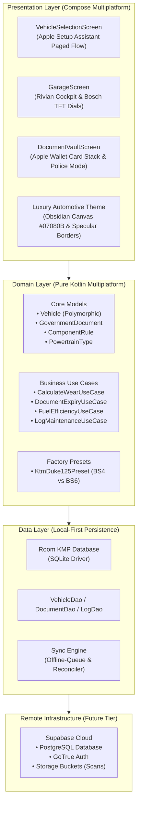
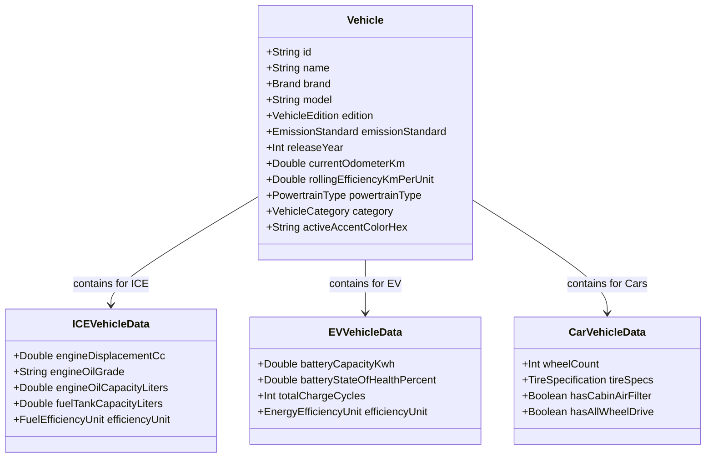
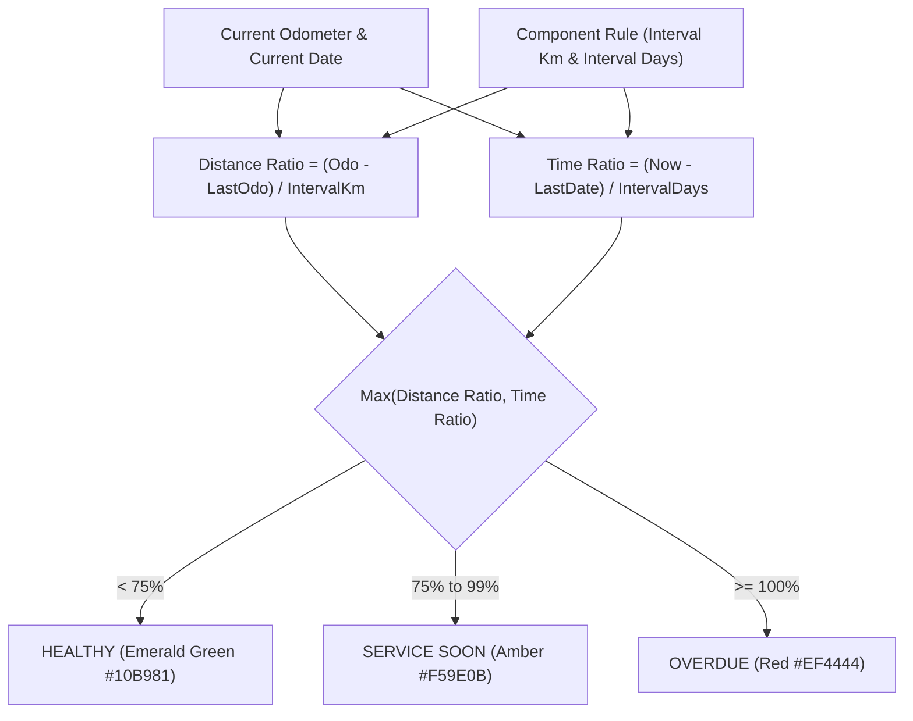
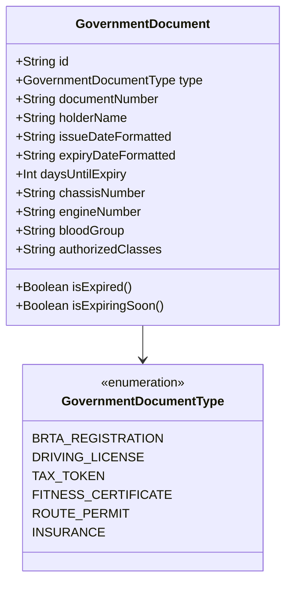

# MotoVault — Architecture, Context & Engineering Handoff

> **Version:** 2.0.0 (Automotive Luxury Edition)  
> **Repository:** [git@github.com:iamarifdev/motovault.git](https://github.com/iamarifdev/motovault)  
> **Platform:** Kotlin Multiplatform (KMP 2.0.21) + Compose Multiplatform (1.7.0)  
> **Target Environments:** Android (API 26+) & iOS (iOS 15+)  
> **Persistence Model:** Local-First (Room KMP / SQLite) with Supabase Cloud Sync  
> **Author & Maintainer:** Md. Arifur Rahman (`iamarifdev`)  

---

## 1. Executive Summary & Product Genesis

### 1.1 The Real-World Problem
In emerging and high-density automotive markets like Bangladesh, vehicle ownership—particularly motorcycle ownership—is hindered by three structural pain points:

1. **Fragmented & Fragile Paper Documents:**
   Vehicle riders must legally carry physical government credentials issued by the **Bangladesh Road Transport Authority (BRTA)**: the *BRTA Registration Smart Card*, the *Driving Licence Card*, and the *Motor Vehicle Tax Token Certificate*. These physical cards are frequently lost, weather-damaged, or forgotten at home, resulting in harassment and heavy penalties at traffic police checkpoints. Existing generic wallet apps do not present authentic Bangladeshi government credentials formatted for roadside traffic police verification.
2. **Ignored Factory Maintenance & Safety Failures:**
   Motorcycles require high-frequency maintenance that differs fundamentally from passenger cars (e.g. open drive chains must be cleaned and lubed every 500 km; single-cylinder high-revving engines require strict 10W-50 oil flushes). Generic maintenance apps lack vehicle-specific factory specifications, forcing riders to manually calculate intervals or guess component health.
3. **Resale Value Destruction:**
   When selling a pre-owned vehicle, sellers lack verifiable maintenance history. Hand-written workshop receipts are easily disputed, depressing vehicle resale value by 15%–30%.

### 1.2 The MotoVault Solution
**MotoVault** is an offline-first vehicle digital passport, maintenance vault, and lifecycle health tracker engineered as a luxury automotive companion. Starting with the user's **KTM Duke 125 Indian Version**, MotoVault delivers:

* **Authentic Bangladeshi Document Vault:** Digital twin of the physical BRTA Smart Card, Driving Licence, and Tax Token with 3D physical card interaction and an emergency **Traffic Police Mode** (max-contrast AMOLED dark canvas, locked personal records, instant inspection layout).
* **Powertrain-Adaptive Intelligence:** Polymorphic domain architecture that dynamically adjusts telemetry, components, and maintenance intervals whether tracking an ICE motorcycle, an EV scooter (e.g., Ather / Revolt), or a 4-wheeler passenger car.
* **Bosch TFT Telemetry Cockpit:** Precision dual-ring instrument dials with outer graduation tick rings, glowing sweep arcs, and dual-threshold wear mathematics ($\Delta \text{distance}$ vs $\Delta \text{time}$).
* **Verified Digital Service Passport:** Exportable, cryptographically verifiable PDF log for workshops and prospective buyers.

---

## 2. High-Level System Architecture

MotoVault follows **Clean Architecture** combined with the **Unidirectional Data Flow (UDF)** pattern in Compose Multiplatform.



---

## 3. Polymorphic Domain Modeling & Specifications

### 3.1 Vehicle Hierarchy & Powertrain Polymorphism
Vehicles are modeled with polymorphism to avoid rigid database schemas that break when switching between combustion engines and electric vehicles:



### 3.2 KTM Duke 125 Specification Matrix
The application encodes exact manufacturer service rules for the KTM Duke 125, accounting for the mechanical differences between regional market editions:

| Specification | Indian Edition (BS4) | Indian Edition (BS6 / OBD-2) | European Edition (Euro 5) |
| :--- | :--- | :--- | :--- |
| **Manufacturing Hub** | Bajaj Auto (Chakan, India) | Bajaj Auto (Chakan, India) | Mattighofen, Austria / Chakan |
| **Active Production Years** | 2018 – early 2020 | 2020 – 2026+ | 2021 – 2026+ |
| **Chassis Architecture** | Lightweight Steel Trellis | Split Trellis Frame (Bolt-on Subframe) | Split Trellis Frame |
| **Exhaust Routing** | Underbelly Exhaust Chamber | Side-Mounted Upswept Exhaust | Side-Mounted with Twin Cat-Con |
| **Fuel Tank Capacity** | **10.2 Liters** | **13.5 Liters** | **13.4 Liters** |
| **Engine Configuration** | 124.7cc DOHC, 4V, Liquid-Cooled | 124.7cc DOHC, 4V, Liquid-Cooled | 124.7cc DOHC, 4V, Liquid-Cooled |
| **Power / Torque** | 14.5 PS @ 9,250 RPM / 12 Nm | 14.5 PS @ 9,250 RPM / 12 Nm | 15.0 PS @ 10,000 RPM / 12 Nm |
| **Factory Oil Spec** | Motul 7100 10W-50 JASO MA2 | Motul 7100 10W-50 JASO MA2 | Motorex Formula 4T 15W-50 |
| **Oil Fill Volume** | 1.50 Liters (with filter) | 1.50 Liters (with filter) | 1.50 Liters (with filter) |
| **Spark Plug Spec** | NGK LKAR8A-9 (0.8–0.9 mm gap) | NGK LKAR8A-9 (0.8–0.9 mm gap) | Bosch VR 5 NEU |
| **Drive Chain Spec** | 520 O-Ring (5–7 mm slack) | 520 X-Ring (5–7 mm slack) | 520 X-Ring (5–7 mm slack) |

---

## 4. Maintenance Wear Engine & Telemetry Mathematics

### 4.1 Dual-Threshold Component Wear Formula
Components degrade both by mechanical mileage ($\text{km}$) and chemical/temporal aging ($\text{days}$). The wear engine evaluates both vectors simultaneously and reports the governing wear percentage:

$$\text{Wear Percentage} = \max\left( \frac{\Delta \text{Distance}}{\text{Interval}_{\text{km}}}, \; \frac{\Delta \text{Days}}{\text{Interval}_{\text{days}}} \right) \times 100$$

Where:
* $\Delta \text{Distance} = \text{Current Odometer} - \text{Last Service Odometer}$
* $\Delta \text{Days} = \text{Current Timestamp} - \text{Last Service Timestamp}$



### 4.2 Edge Case Defenses & Safeguards
1. **Odometer Rollback / Typo Protection:**
   If $\text{Current Odometer} < \text{Last Service Odometer}$, the wear percentage returns $0\%$ and flags an integrity anomaly rather than throwing a negative overflow.
2. **Zero-Interval Division by Zero Defense:**
   If a rule has an interval of $0\text{ km}$ or $0\text{ days}$, the system clamps the denominator to prevent arithmetic crashes.
3. **1-Tap Quick Log Chain Lube:**
   The drive chain interval is reset instantly without requiring full service checklist forms, updating `lastServiceOdometerKm = currentOdometerKm`.

### 4.3 Fuel Efficiency Telemetry (Full-to-Full Method)
Fuel economy is computed using the industry-standard full-to-full telemetry method:

$$\text{Efficiency } (\text{km/L}) = \frac{\text{Odometer}_{\text{current}} - \text{Odometer}_{\text{previous}}}{\text{Fuel Added}_{\text{liters}}}$$

* **Partial Fill-ups:** Logged as intermediate fuel checkpoints without corrupting the rolling average calculation until the next tank-to-tank full fill-up is registered.

---

## 5. Bangladeshi Regulatory Document Tracking (BRTA)

MotoVault includes native domain modeling for Bangladeshi road transport credentials:



### 5.1 Document Expiry Alert Windows
* **Healthy Status:** $> 60$ days remaining before expiration.
* **Expiring Soon Status:** $\le 60$ days remaining (triggers yellow amber countdown pill).
* **Expired Status:** $\le 0$ days remaining (triggers high-priority red alert and reminder notifications).

---

## 6. Luxury Automotive UI/UX Design System (v2.0)

MotoVault's interface is built upon a cohesive luxury design system synthesized from **Rivian OS 3.0**, **Apple Wallet**, and **Bosch TFT Digital Cockpits**:

### 6.1 Design Tokens & Surface Architecture

```
Canvas Background:       #07080B (Deep Obsidian Black)
Surface Card Gradient:   LinearGradient(#161922 -> #111319)
Surface Elevated:        #1A1D26
Glass Surface:           rgba(18, 21, 28, 0.75) with blur(24px)
Hairline Specular Border:1px rgba(255, 255, 255, 0.08)
Highlight Top Border:    1px rgba(255, 255, 255, 0.15)
Apex Orange Accent:      #FF6600 (KTM Racing Orange)
Healthy Status:          #10B981 (Emerald Green)
Warning Status:          #F59E0B (Amber Gold)
Overdue Status:          #EF4444 (Crimson Red)
```

### 6.2 Key Screen Archetypes

#### 1. Onboarding (`VehicleSelectionScreen.kt`)
* **Interaction Model:** Apple Setup Assistant 3-Step Paged Flow with animated horizontal slide transitions.
* **Progress Indicator:** Tactile pill-dot indicators (active step expands to a 24.dp pill; inactive steps are 8.dp dots).
* **Step 1 (Brand & Model):** 2x2 grid of brand cards (KTM active; Yamaha, Ather, Royal Enfield with "Soon" badges). Hero card for KTM Duke 125.
* **Step 2 (Edition & Emission):** Segmented pill switch for Indian Edition vs European Edition. Dynamically filtered emission standard cards (BS6 with 13.5L tank vs BS4 with 10.2L tank).
* **Step 3 (Odometer & Specs):** Monospace odometer input field with quick increment chips (`1,000 km`, `4,200 km`, `10,000 km`) and factory specification preview.

#### 2. Digital Cockpit Dashboard (`GarageScreen.kt`)
* **Vehicle Hero Stage:** Obsidian card with ambient radial orange halo spotlight, "READY TO RACE" badge, vehicle displacement subtitle, and a precision stats bar showing Odometer and Fuel Economy separated by a vertical hairline divider.
* **Bosch TFT Precision Dials:** 3-column instrument cluster for Drive Chain, Engine Oil, and Air Filter.
  * 36 radial graduation ticks drawn on `Canvas`.
  * Specular inset track ring.
  * Glowing neon progress sweep arc with drop shadow.
  * Centered monospace percentage readout with micro status capsule pill.
* **Factory Maintenance Schedule:** Specular checklist cards with component icons and wear percentages.
* **Floating Quick Action Dock:** Persistent bottom pill bar with spring-scaled buttons for 1-Tap Chain Lube, Fuel Log, and Traffic Police Mode.

#### 3. Apple Wallet Document Stack (`DocumentVaultScreen.kt`)
* **Vertical Passbook Stack:** 3 authentic Bangladeshi physical credentials rendered with skeuomorphic microchips, national emblems, and realistic gradients:
  * **BRTA Registration Smart Card:** Emerald Green (`#0B3323` to `#082217`), national flag emblem, gold microchip, `DHAKA METRO-HA 45-8821`.
  * **BRTA Driving Licence:** Navy Blue (`#132A4A` to `#0C1E36`), photo avatar, `DK0182949CL`, holder name, blood group B+.
  * **BRTA Tax Token Certificate:** Warm Bronze (`#3B2A0F` to `#241A09`), countdown `48 Days Remaining`.
* **Stack Physics:** Fanned card peek with spring physics (`dampingRatio = 0.82f, stiffness = 280f`). Tapping any peeking card brings it to the front.
* **3D Flip Interaction:** Tapping the active card or the "Flip Card" button rotates the card 180° along the Y-axis (`graphicsLayer { rotationY, cameraDistance }`) to inspect chassis and engine numbers.
* **Traffic Police Mode:**
  * One-tap activation switches the entire display to **AMOLED Pure Pitch Black (`#000000`)**.
  * Displays an urgent verification header: `🚨 OFFICIAL POLICE VERIFICATION DISPLAY`.
  * Hides all private financial and maintenance records.
  * Applies maximum-contrast 2.dp neon borders for instant officer inspection.

---

## 7. Project Directory Layout & Source Organization

```
motovault/
├── composeApp/
│   ├── build.gradle.kts                   # KMP, AGP, Compose Multiplatform configuration
│   └── src/
│       ├── androidMain/
│       │   ├── AndroidManifest.xml        # Edge-to-edge support & launcher intent
│       │   └── kotlin/com/motovault/app/
│       │       └── MainActivity.kt        # Android Activity hosting App() Composable
│       ├── commonMain/
│       │   └── kotlin/com/motovault/app/
│       │       ├── App.kt                 # Root navigation controller & dynamic theme host
│       │       ├── domain/
│       │       │   ├── model/
│       │       │   │   ├── ComponentRule.kt       # Dual-threshold wear entity
│       │       │   │   ├── GovernmentDocument.kt  # BRTA document entity
│       │       │   │   ├── Powertrain.kt          # ICE & EV polymorphic enums
│       │       │   │   └── Vehicle.kt             # Core vehicle entity & brand enums
│       │       │   ├── preset/
│       │       │   │   └── KtmDuke125Preset.kt    # Factory KTM specs, BS4 & BS6 schedules
│       │       │   └── usecase/
│       │       │       ├── CalculateWearUseCase.kt # Wear percentage math engine
│       │       │       ├── DocumentExpiryUseCase.kt# Expiry calculation engine
│       │       │       ├── FuelEfficiencyUseCase.kt# Full-to-full telemetry engine
│       │       │       └── LogMaintenanceUseCase.kt# 1-tap reset and full service logger
│       │       ├── theme/
│       │       │   ├── Color.kt           # Obsidian surfaces, specular borders, gradients
│       │       │   ├── Theme.kt           # MotoVaultTheme Composable & darkColorScheme
│       │       │   └── Type.kt            # Monospace telemetry & display typography
│       │       └── ui/
│       │           ├── garage/
│       │           │   ├── GarageScreen.kt         # Cockpit dashboard & maintenance list
│       │           │   └── components/
│       │           │       ├── QuickActionBar.kt   # Floating frosted action dock
│       │           │       └── WearGauge.kt        # Bosch TFT Inset Dial Composable
│       │           ├── onboarding/
│       │           │   └── VehicleSelectionScreen.kt # 3-step paged onboarding flow
│       │           └── vault/
│       │               ├── DocumentVaultScreen.kt  # Apple Wallet vertical stack & police mode
│       │               └── components/
│       │                   └── SkeuomorphicSmartCard.kt # 3D flip card component
│       ├── commonTest/
│       │   └── kotlin/com/motovault/app/domain/
│       │       ├── preset/
│       │       │   └── KtmDuke125PresetTest.kt
│       │       └── usecase/
│       │           ├── CalculateWearUseCaseTest.kt
│       │           ├── DocumentExpiryUseCaseTest.kt
│       │           ├── FuelEfficiencyUseCaseTest.kt
│       │           └── LogMaintenanceUseCaseTest.kt
│       └── iosMain/                       # iOS Entry point bindings
├── gradle/
│   ├── libs.versions.toml                 # Version catalog (Kotlin 2.0.21, Compose 1.7.0)
│   └── wrapper/
│       └── gradle-wrapper.properties      # Gradle 8.10.2 distribution
├── docs/
│   └── ARCHITECTURE_AND_HANDOFF.md        # In-repo copy of this handoff document
└── local.properties                       # Android SDK location
```

---

## 8. Verification & Automated Test Suite

MotoVault includes **21 automated unit tests** that verify all domain logic and edge cases.

### 8.1 Test Coverage Breakdown

| Test Suite File | Test Count | Key Invariants Verified |
| :--- | :--- | :--- |
| [`CalculateWearUseCaseTest.kt`](file:///Users/arif/workspace/bbn/motovault/composeApp/src/commonTest/kotlin/com/motovault/app/domain/usecase/CalculateWearUseCaseTest.kt) | 7 tests | Distance-governed wear, time-governed wear, 100% overdue boundary, zero-interval safety, odometer rollback defense, healthy status transitions |
| [`FuelEfficiencyUseCaseTest.kt`](file:///Users/arif/workspace/bbn/motovault/composeApp/src/commonTest/kotlin/com/motovault/app/domain/usecase/FuelEfficiencyUseCaseTest.kt) | 5 tests | Full-to-full consumption calculations, rolling efficiency averages, partial fill-up handling, zero-volume division safety, negative distance defenses |
| [`DocumentExpiryUseCaseTest.kt`](file:///Users/arif/workspace/bbn/motovault/composeApp/src/commonTest/kotlin/com/motovault/app/domain/usecase/DocumentExpiryUseCaseTest.kt) | 4 tests | Valid active documents (>60 days), expiring soon alert window ($\le 60$ days), expired documents ($\le 0$ days), negative elapsed days |
| [`KtmDuke125PresetTest.kt`](file:///Users/arif/workspace/bbn/motovault/composeApp/src/commonTest/kotlin/com/motovault/app/domain/preset/KtmDuke125PresetTest.kt) | 3 tests | BS4 10.2L vs BS6 13.5L tank capacity, all 7 factory component rules populated, correct 10W-50 oil specifications |
| [`LogMaintenanceUseCaseTest.kt`](file:///Users/arif/workspace/bbn/motovault/composeApp/src/commonTest/kotlin/com/motovault/app/domain/usecase/LogMaintenanceUseCaseTest.kt) | 2 tests | 1-tap chain lube resets (500 km interval), full service overhaul resets (resets all active component wear counters) |

---

## 9. Environment Setup & Execution Commands

### 9.1 Prerequisites
* **JDK:** Native Apple Silicon ARM64 OpenJDK 17 (e.g., `/opt/homebrew/opt/openjdk@17`).
* **Android SDK:** Installed at `/Users/arif/Library/Android/sdk` with Platform-Tools (`adb`).
* **Gradle:** Version **8.10.2** (Gradle 9 is incompatible with AGP 8.7.1).

### 9.2 Key Terminal Commands

```bash
# 1. Run the entire test suite
JAVA_HOME=/opt/homebrew/opt/openjdk@17/libexec/openjdk.jdk/Contents/Home ./gradlew test

# 2. Build the Debug APK
JAVA_HOME=/opt/homebrew/opt/openjdk@17/libexec/openjdk.jdk/Contents/Home ./gradlew :composeApp:assembleDebug

# 3. Install on a running Android emulator or device
/Users/arif/Library/Android/sdk/platform-tools/adb install -r composeApp/build/outputs/apk/debug/composeApp-debug.apk

# 4. Launch the application
/Users/arif/Library/Android/sdk/platform-tools/adb shell am start -n com.motovault.app/.MainActivity

# 5. Capture a live screenshot for visual inspection
/Users/arif/Library/Android/sdk/platform-tools/adb exec-out screencap -p > screenshot.png
```

---

## 10. Future Extension Guides for Incoming Engineers

### 10.1 Adding a New Vehicle Brand / Model Preset
To add a new vehicle (e.g., **Ather 450X EV** or **Yamaha R15 V4**):
1. In `Brand.kt`, set `isAvailable = true` for `Brand.YAMAHA` or `Brand.ATHER`.
2. Create a new preset file `composeApp/src/commonMain/kotlin/com/motovault/app/domain/preset/YamahaR15V4Preset.kt`:
   * Define displacement, oil volume, and tank capacity.
   * Provide `defaultComponentRules(vehicleId: String, currentOdo: Double): List<ComponentRule>`.
3. In `VehicleSelectionScreen.kt`, allow selection of the new model and wire it to the preset factory.
4. Add corresponding unit tests in `commonTest`.

### 10.2 Integrating Room KMP Local Persistence
1. Add Room KMP dependencies to `libs.versions.toml`:
   * `androidx.room:room-compiler`
   * `androidx.room:room-runtime`
   * `androidx.sqlite:sqlite-bundled`
2. Define entities: `@Entity data class VehicleEntity(...)` and `@Entity data class DocumentEntity(...)`.
3. Define DAOs: `VehicleDao` with `@Query("SELECT * FROM vehicles") fun getAllVehicles(): Flow<List<VehicleEntity>>`.
4. Create the Room Database: `@Database(entities = [VehicleEntity::class], version = 1) abstract class MotoVaultDatabase : RoomDatabase()`.
5. Provide a shared Koin module that instantiates the database using the platform-specific SQLite driver (`bundledSQLiteDriver()`).

### 10.3 Integrating Supabase Cloud Sync
1. Add the Supabase Kotlin SDK (`io.github.jan-tennert.supabase:postgrest-kt`, `gotrue-kt`, `storage-kt`).
2. Maintain a local `sync_state` column (`PENDING`, `SYNCED`, `CONFLICT`) on all Room entities.
3. On network availability, upload un-synced entries using Supabase Row Level Security (RLS) linked to `auth.uid()`.
4. Store encrypted document card images in a private Supabase Storage bucket (`user-vault-documents`).

### 10.4 Implementing Physical Document Optical Scanning (OCR)
1. Add Google ML Kit Document Scanner / Text Recognition:
   * On Android: CameraX with `ImageAnalysis.Analyzer` scanning for ISO ID-1 (credit-card size) bounding box.
   * On iOS: Apple Vision Framework `VNRecognizeTextRequest`.
2. Extract the regex patterns:
   * Vehicle Registration: `DHAKA METRO-[A-Z]{1,2}\s*\d{2}-\d{4}`
   * Driving Licence: `[A-Z]{2}\d{9}[A-Z]{2}`
   * Tax Token: `TT-\d{6}-\d{4}`
3. Pre-populate the `GovernmentDocument` fields automatically with high confidence.

### 10.5 Generating Verified Digital Service Passport (PDF)
1. Implement a PDF generation use case (`ExportServicePassportUseCase`).
2. Include:
   * Vehicle VIN/Chassis and BRTA registration number.
   * Chronological service timeline with odometer stamps, parts replaced, and costs.
   * QR code containing a SHA-256 cryptographic hash of the service log for buyer verification.
